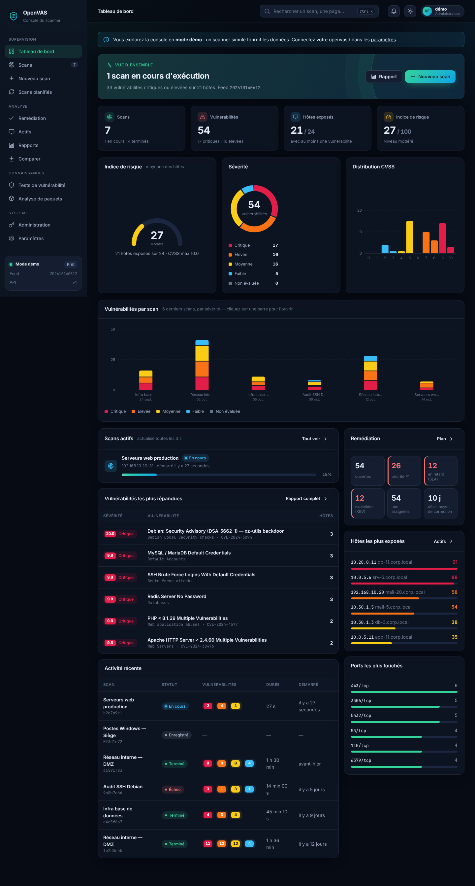

# OpenVAS Console

Interface web moderne pour [openvas-scanner](https://github.com/greenbone/openvas-scanner).

`openvas-scanner` n'a pas d'interface graphique : c'est le moteur de scan, piloté par l'API REST
**openvasd** (`rust/api/openapi.yml`). Cette console se branche directement sur cette API :
elle ne modifie pas le scanner, elle en devient l'interface.



## Fonctionnalités

| Page | Endpoints openvasd |
| --- | --- |
| **Tableau de bord** : KPI, scans actifs en direct, répartition par sévérité CVSS, hôtes les plus exposés, familles de VT | `HEAD /health`, `GET /health/*`, `GET /scans`, `/scans/{id}/status`, `/scans/{id}/results` |
| **Scans** : recherche, filtres par statut, progression en temps réel, démarrage, arrêt, suppression | `GET /scans`, `POST /scans/{id}`, `DELETE /scans/{id}` |
| **Détail d'un scan** : progression par hôte, vulnérabilités triées par CVSS, détail et solution, vue par hôte, export CSV/JSON | `GET /scans/{id}`, `/status`, `/results?range=n` (incrémental) |
| **Nouveau scan** : cibles, ports, détection d'hôtes, identifiants SSH/SMB/ESXi/SNMP, familles de VT, préférences du scanner, aperçu JSON de la requête | `GET /scans/preferences`, `POST /scans` |
| **Actifs** : inventaire des hôtes (système, ports, indice de risque 0–100), tri, filtres, fiche hôte avec historique, export CSV | résultats agrégés |
| **Rapports** : synthèse rédigée, jauge de risque, répartition par sévérité, distribution CVSS, évolution dans le temps, matrice de risque hôtes × sévérité, priorités de correction ; impression / PDF | résultats agrégés |
| **Comparer** : deux scans côte à côte, vulnérabilités nouvelles, corrigées et persistantes | résultats agrégés |
| **Tests de vulnérabilité** : catalogue du feed, filtres famille/sévérité, fiche détaillée (CVE, vecteur, solution) | `GET /vts?information=1` |
| **Analyse de paquets** (Notus) : vulnérabilités d'une liste de paquets installés | `GET /notus`, `POST /notus/{os}` |
| **Paramètres** : connexion, clé API, intervalle d'actualisation, thème | — |

### Fonctions d'équipe SSI / SOC

| Fonction | Ce qu'elle apporte |
| --- | --- |
| **Comptes et rôles** | Écran de connexion ; *admin* (tout), *analyste* (scans, triage, remédiation, planifications), *lecteur* (consultation et rapports). Mots de passe hachés (scrypt), sessions de 12 h, blocage après 5 échecs. |
| **Remédiation** | Plan de traitement partagé : statut (à traiter, confirmée, en correction, corrigée, risque accepté, faux positif), responsable, échéance, commentaires et historique ; vues « mes vulnérabilités », « en retard », « exploitées », « non assignées » ; export CSV. |
| **Priorisation** | Priorité P1 à P4 calculée à partir du CVSS, du catalogue **CISA KEV** (vulnérabilités exploitées activement), du score **EPSS** (probabilité d'exploitation) et de la criticité de l'actif. |
| **SLA** | Échéance automatique selon la sévérité (par défaut : 7 j critique, 30 j élevée, 90 j moyenne, 180 j faible), retards signalés, délai moyen de correction (MTTR). |
| **Actifs** | Criticité métier, propriétaire et environnement de chaque hôte ; la criticité pondère le risque. |
| **Scans planifiés** | Quotidien, hebdomadaire ou mensuel, exécutés par le serveur même navigateur fermé. |
| **Alertes** | Résumé de fin de scan envoyé vers Slack, Teams, Mattermost, Rocket.Chat ou Discord (webhook) et dans le fil d'activité de l'équipe. |
| **Journal d'audit** | Qui a lancé, arrêté ou supprimé un scan, modifié un suivi, un compte ou un réglage, et quand. |

Les données d'équipe sont stockées dans `data/` (`state.json`, `users.json`, `audit.log`), à sauvegarder avec la VM.
Les faux positifs sont exclus des graphiques. Un scan peut être **dupliqué** pour relancer la même configuration.

Le reste de l'interface : thème sombre et clair, palette de commandes (<kbd>Ctrl</kbd>+<kbd>K</kbd>), affichage adapté au mobile, et un **mode démo** qui simule un scanner pour essayer la console sans openvasd.

## Démarrage

Requiert Node.js ≥ 18, aucune dépendance à installer.

```sh
cd openvas-console
OPENVASD_URL=http://127.0.0.1:3000 OPENVASD_API_KEY=changeme node server.mjs
# → http://127.0.0.1:8080
```

`server.mjs` sert l'interface et relaie `/api/*` vers openvasd. Ce proxy est nécessaire parce
qu'openvasd n'envoie pas d'en-têtes CORS. Il permet aussi de garder la clé API et le certificat
client côté serveur.

| Variable | Rôle | Défaut |
| --- | --- | --- |
| `PORT` / `HOST` | Adresse d'écoute de la console | `8080` / `127.0.0.1` |
| `OPENVASD_URL` | URL d'openvasd | `http://127.0.0.1:3000` |
| `OPENVASD_API_KEY` | Clé ajoutée à chaque requête (`X-API-KEY`) | — |
| `OPENVASD_CERT` / `OPENVASD_KEY` / `OPENVASD_CA` | Certificats PEM pour le mTLS | — |
| `DATA_DIR` | Données d'équipe, comptes, journal d'audit | `./data` |
| `CACHE_DIR` | Catalogue des tests | `./cache` |

Le renseignement CISA KEV / EPSS nécessite que la VM puisse joindre `www.cisa.gov` et `api.first.org`.

### Comptes

Tant qu'aucun compte n'existe, la console est ouverte (un bandeau « Console ouverte » le rappelle).
Créez un administrateur, en ligne de commande ou depuis **Administration → Comptes** :

```sh
node server.mjs user add admin admin        # demande le mot de passe
node server.mjs user add amina analyste
node server.mjs user list
```

Dès le premier compte, la connexion devient obligatoire pour tous.

Au premier lancement, la console passe en mode réel si openvasd répond, sinon en mode démo.
Vous pouvez changer de mode dans **Paramètres**.

### Catalogue des tests (VT)

Les résultats d'openvasd ne contiennent que l'identifiant (OID) du test. Au démarrage, `server.mjs` télécharge
une seule fois les métadonnées du feed (`GET /vts?information=1`), en garde une copie compacte dans `cache/`
et la renouvelle quand la version du feed change. Le navigateur ne demande ensuite que les tests présents
dans ses résultats : noms, scores CVSS, solutions et CVE s'affichent automatiquement. La préparation prend
quelques minutes la première fois ; l'état est visible dans **Paramètres**.

### Remarques

- Pour lister tous les scans, lancez openvasd avec `--enable-get-scans`. Sans cette option, la console n'affiche que les scans créés depuis ce navigateur.
- Le nom d'un scan n'existe pas dans l'API : il est enregistré localement, dans le navigateur.

## Structure

```
openvas-console/
├── server.mjs            serveur, proxy openvasd, API de la console, comptes (CLI)
├── lib/
│   ├── catalog.mjs       catalogue VT compact, mis en cache sur disque
│   ├── auth.mjs          comptes, rôles, sessions
│   ├── state.mjs         données d'équipe et journal d'audit
│   ├── intel.mjs         CISA KEV et EPSS
│   └── automation.mjs    scans planifiés, alertes de fin de scan
└── public/
    ├── index.html
    ├── css/app.css       design system (tokens, thèmes, composants)
    └── js/
        ├── api.js        client openvasd + réglages
        ├── mock.js       scanner simulé (mode démo)
        ├── store.js      cache, résultats incrémentaux, catalogue VT
        ├── util.js       CVSS v2/v3, formats, icônes
        ├── ui.js         toasts, dialogues, tiroir, palette
        ├── charts.js     graphiques SVG (barres, histogramme, anneau, jauge, matrice)
        ├── analytics.js  agrégation, indice de risque, comparaison, suivi
        ├── actions.js    démarrer / arrêter / supprimer
        ├── team.js       utilisateur connecté, données partagées
        ├── app.js        shell, routeur, connexion, thème
        └── views/        une page par fichier
```
