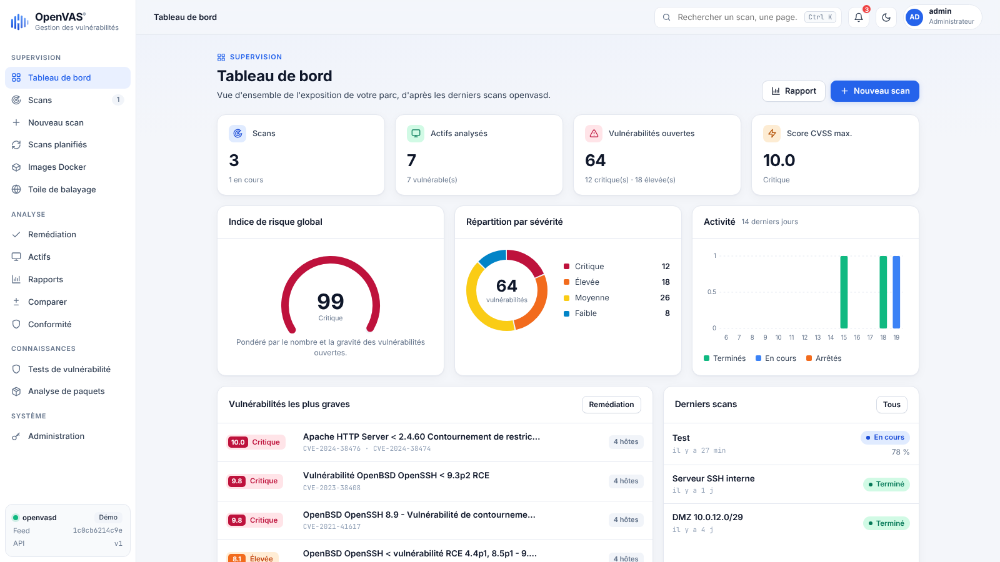
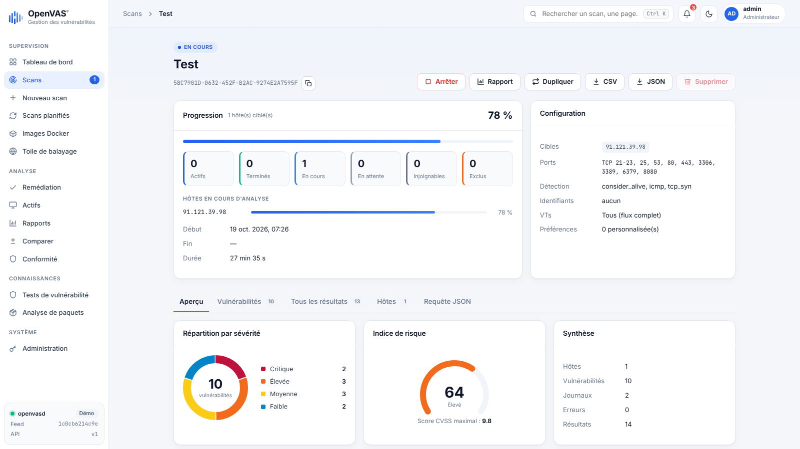
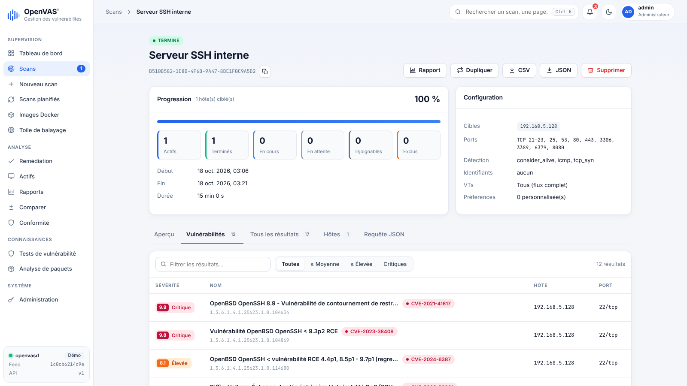
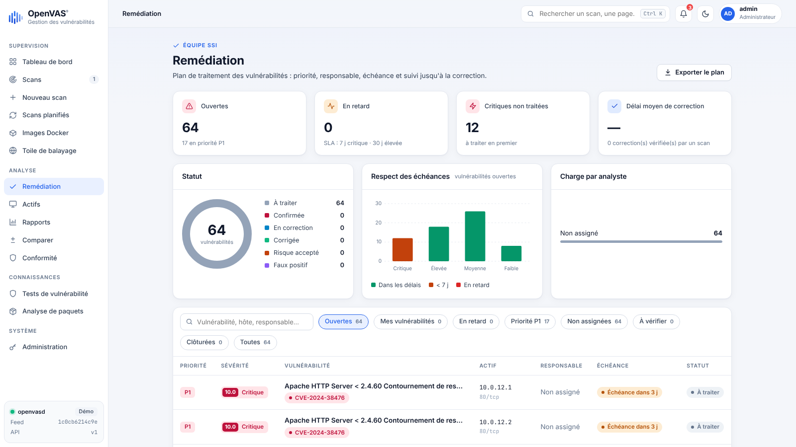
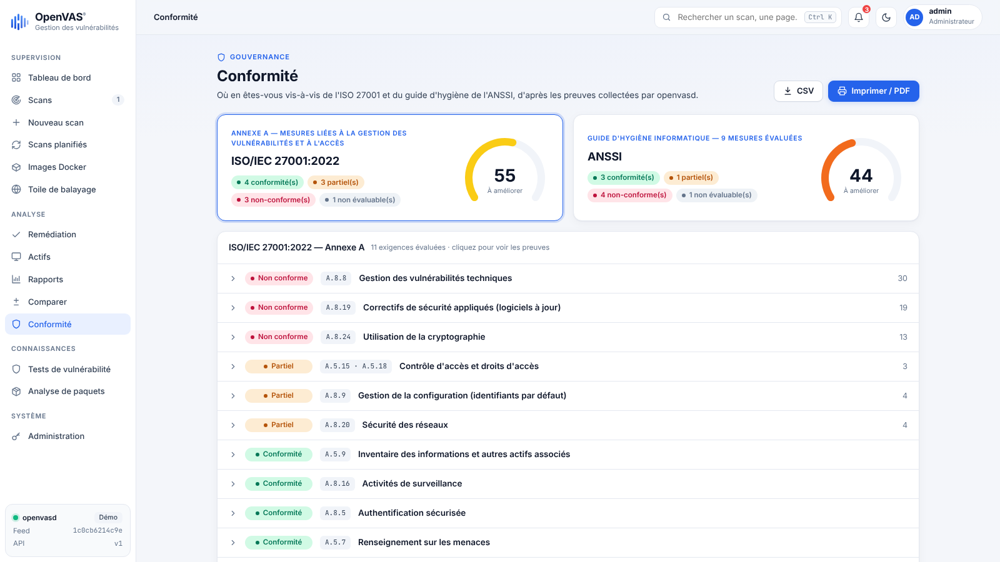

# Interface web OpenVAS

Console de gestion des vulnérabilités pour **openvasd** (l'API HTTP de
[openvas-scanner](https://github.com/greenbone/openvas-scanner)), en français,
avec thème clair / sombre.



| Scan en cours | Vulnérabilités |
|---|---|
|  |  |
| **Remédiation** | **Conformité** |
|  |  |

## Pages

| Section | Pages |
|---|---|
| Supervision | Tableau de bord, Scans, Nouveau scan, Scans planifiés, Sites web, Images Docker, Toile de balayage |
| Analyse | Remédiation, Actifs, Rapports (PDF, Word, CSV), Comparer, Conformité (ISO 27001 / ANSSI) |
| Connaissances | Tests de vulnérabilité (flux de VTs), Analyse de paquets (Notus) |
| Système | Utilisateurs (rôles administrateur / développeur / visiteur), Journal d'activité, Administration |

Le détail d'un scan affiche la progression par hôte, la configuration et les
onglets Aperçu, Vulnérabilités, Tous les résultats, Hôtes et Requête JSON, avec
export CSV / JSON, duplication, pause, reprise, arrêt et suppression (aussi
en lot depuis la liste des scans). openvasd ne sachant pas suspendre un scan,
la pause l'arrête et « Reprendre » le relance en ignorant les hôtes terminés.

## Démarrage

Aucune dépendance : Python 3.9+ suffit.

```bash
# Essai avec un openvasd simulé
python3 server.py --demo
# → http://127.0.0.1:8080

# Avec un vrai openvasd
python3 server.py --openvasd http://127.0.0.1:3000 --api-key VOTRE_CLE
```

Options utiles (également disponibles en variables d'environnement) :

| Option | Variable | Rôle |
|---|---|---|
| `--openvasd` | `OPENVASD_URL` | URL d'openvasd |
| `--api-key` | `OPENVASD_API_KEY` | En-tête `X-API-KEY` |
| `--client-cert`, `--client-key`, `--cafile` | `OPENVASD_CLIENT_CERT`, … | mTLS |
| `--host`, `--port` | `OPENVAS_UI_HOST`, `OPENVAS_UI_PORT` | Écoute de l'interface (défaut `127.0.0.1:8080`) |
| `--data` | `OPENVAS_UI_DATA` | Dossier de données |

### Production (Ubuntu, avec d'autres conteneurs)

Suivez le guide pas à pas [deploy/INSTALLATION.md](deploy/INSTALLATION.md) : il déploie
openvasd et l'interface dans un projet Docker isolé (`openvas-console`).

### Docker (interface seule)

```bash
docker build -t openvas-ui .
docker run -p 8080:8080 -v openvas-ui:/data \
  -e OPENVASD_URL=http://openvasd:80 -e OPENVASD_API_KEY=changeme openvas-ui
```

Avec le `compose` d'openvas-scanner, placez le conteneur sur le même réseau
qu'`openvasd`.

## Fonctionnement

`server.py` sert l'interface et fait office de passerelle vers openvasd :

- la clé API (ou le certificat client) reste côté serveur, le navigateur ne
  parle qu'à `/api/*` ;
- au démarrage, les métadonnées des VTs (`GET /vts?information=1`) sont chargées
  et mises en cache dans `data/vts-cache.json` pour la version du flux ; elles
  servent à calculer le score CVSS (v3.x / v2), le niveau de sévérité, la
  solution et les CVE de chaque résultat ;
- openvasd ne stockant ni nom de scan ni suivi, l'interface conserve dans
  `data/state.json` : le nom des scans, la requête envoyée (secrets masqués),
  le suivi de remédiation, les planifications et les notifications ;
- les scans planifiés sont lancés par un planificateur intégré (vérification
  toutes les 30 s), le serveur doit donc rester démarré.

L'interface n'a pas de gestion d'utilisateurs : exposez-la derrière un
reverse-proxy authentifié (ou laissez-la sur `127.0.0.1`).
